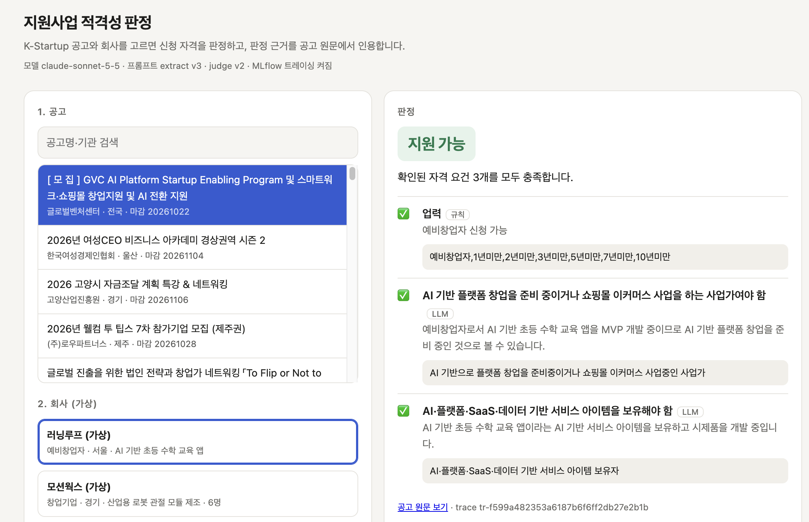
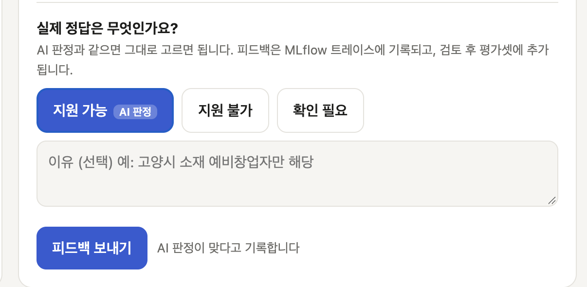

# 지원사업 적격성 판정 에이전트

K-Startup 창업지원사업 공고와 회사 프로필을 넣으면 **지원 가능 / 지원 불가 / 확인 필요**를 판정하고, 판정 근거를 **공고 원문에서 인용**하는 LLM 에이전트입니다. MLflow로 트레이싱, 프롬프트 버전 관리, 평가를 운영합니다.

> 자매 프로젝트 [mlops-eurosat](https://github.com/teraglass/mlops-eurosat)의 MLOps 라이프사이클(실험 추적 → 평가 → 승격 → 모니터링)을 LLM 애플리케이션에 적용한 프로젝트입니다.

## 구조

```
공고 ──▶ [1] extract_criteria (LLM, 공고당 1회 캐시)
              나이·업력·지역 조건 + 기타 요건 + 원문 인용
              │
회사 ──▶ [2] rule_checks (코드)        나이·업력·지역은 계산으로 판정
         [3] judge_other (LLM)        업종·기업형태 등 나머지만 LLM 판정
         [4] validate_evidence (코드)  인용이 공고 원문에 실제로 있는지 검사
         [5] aggregate (코드)          결정 규칙으로 최종 판정
```

- **숫자 조건은 코드로**: 만 나이·업력 계산을 LLM에 맡기지 않습니다. LLM은 "만 39세 이하"를 `age_max=39`로 추출만 하고, 비교는 코드가 합니다. 같은 입력에 항상 같은 답이 나오고 테스트할 수 있습니다.
- **근거 검증**: 모든 요건에 원문 인용을 요구하고, 인용이 실제 공고에 없으면(환각) 그 근거로 내린 "지원 불가"를 믿지 않고 "확인 필요"로 낮춥니다.
- **결정 규칙이 코드**: 최종 판정은 LLM이 아니라 `aggregate()`의 규칙으로 내립니다. 왜 그 판정이 나왔는지 항상 설명할 수 있습니다.
- **트레이싱**: 각 단계가 MLflow 트레이스의 span으로 남아 단계별 입력·출력·토큰을 UI에서 봅니다.
- **프롬프트 레지스트리**: 프롬프트는 `prompts/*.txt`에서 관리하고 MLflow에 버전으로 등록, 실행 시 `@production` alias로 불러옵니다.

## 빠른 시작

```bash
make setup          # 의존성 + .env 생성 → ANTHROPIC_API_KEY, DATA_GO_KR_API_KEY 입력
make mlflow-up      # MLflow (mlops-eurosat의 MLflow가 떠 있으면 생략)

make inspect        # K-Startup API 실제 응답 필드 확인
make fetch          # 공고 수집 → data/announcements.jsonl
make prompts        # 프롬프트를 레지스트리에 등록 (@production)

make list           # 공고 ID · 프로필 확인
make assess A=<공고ID> P=p02
make label          # 평가셋 정답 라벨링 → data/eval_set.jsonl

make eval                          # 현재 @production 프롬프트 평가 → MLflow run
make eval EX=2 JU=2                # 후보 프롬프트 버전 평가
make eval MODEL=claude-haiku-5-5   # 모델 비교
make promote R=<run_id>            # 승격 게이트 → 통과하면 @production 이동

make serve                         # API + 데모 페이지 → http://127.0.0.1:8000
make reload                        # 승격 후 서버 재시작 없이 새 프롬프트 반영
make feedback                      # 데모 피드백 검토 (APPLY=1: 평가셋에 추가)
```

## 평가와 승격

`make eval`은 평가셋 전체를 `mlflow.genai.evaluate`로 돌려 사례마다 트레이스와 평가 기준 결과를 남기고, 집계 지표를 run 하나에 기록합니다. run 태그에 모델·프롬프트 버전·평가셋 해시가 남아 조건별 run을 MLflow UI에서 비교할 수 있습니다.

| 평가 기준 | 구현 | 보는 것 |
|---|---|---|
| `verdict_correct` | 코드 | 정답 라벨과 일치 |
| `no_false_rejection` | 코드 | 지원 가능·확인 필요인 회사에 "지원 불가"라고 단정하지 않음 (가장 치명적인 실수) |
| `evidence_grounded` | 코드 | 판정에 쓴 인용이 모두 공고 원문에 있음 |
| `reasons_faithful` | LLM 심사 (`JUDGE=1`) | LLM이 쓴 판정 이유가 회사 정보와 모순되지 않음 |

집계 지표는 정확도, macro-F1, 클래스별 재현율, 잘못된 탈락 비율, 근거 유효율, 비용, 지연입니다. 평가셋은 "지원 불가"가 다수라 **항상 지원 불가라고만 답해도 정확도가 높게** 나오므로, 이 단순 기준선(`baseline_majority_accuracy`)을 함께 기록합니다.

**승격 게이트**(`make promote`)는 후보 run을 같은 모델·평가셋으로 평가한 현재 `@production` run과 비교해, 아래를 모두 만족할 때만 두 프롬프트의 `@production` alias를 옮깁니다.

- 정확도: 기준 이상
- 잘못된 탈락 비율: 기준 이하 (정확도가 올라도 이게 늘면 차단)
- 근거 유효율: 기준 이상, 최소 95%
- 건당 비용: 기준의 1.5배 이하
- 실행 오류: 0건

롤백은 예전 버전으로 평가한 run을 `FORCE=1`로 승격하면 됩니다.

## 평가 결과

평가셋 40건 (공고 8 × 가상 회사 5, 정답 분포 지원 불가 28 / 지원 가능 9 / 확인 필요 3), Claude Sonnet 5.5.

| 단계 | 정확도 | macro-F1 | 잘못된 탈락 | 건당 비용 |
|---|---|---|---|---|
| 항상 "지원 불가"로 답하기 (기준선) | 70.0% | – | – | – |
| v1 프롬프트 + 개선 전 코드 | 72.5%¹ | 0.475¹ | 40.0%¹ | $0.0060 |
| v1 프롬프트 + 개선 코드 | 80.0% | 0.658 | 8.3% | $0.0057 |
| **v3 프롬프트 + 개선 코드 (현재 `@production`)** | **97.5%** | **0.928** | **8.3%** | **$0.0056** |

¹ 라벨 재검토 전 평가셋 기준 (아래 참고). 같은 v1 프롬프트를 Haiku 5.5로 돌리면 정확도 65.0%, 비용은 1/11.

### 무엇을 고쳤나 (기준 평가의 오답 분석 → 원인별 수정)

| 오답 유형 | 원인 | 수정 |
|---|---|---|
| "누구나 신청 가능" 행사에서 체크박스 지역·업력으로 탈락 | 코드가 체크박스 분류를 그대로 믿음 | 본문이 "누구나"를 명시하면 체크박스 제한 무시 |
| 행사 개최지를 소재지 요건으로 판정 | 지원지역 체크박스 의미가 공고마다 다름 | 행사ㆍ네트워크 공고는 개최지로, 공고명만 행사 같으면 "불명확" |
| 업력 초과지만 "벤처기업" 대안 경로가 있는 회사를 탈락 | 대안 자격을 추출하지 않음 | `business_exception` 추출, 있으면 탈락 대신 확인 필요 |
| 체납·입주 이력 등 결격 사유를 "정보 없음"으로 보류 | judge 프롬프트에 결격 사유 처리 규칙 없음 | 해당 근거가 없으면 통과 (judge v2) |
| 평가 기준·허용 문장("협업 방향을 제시할 수 있는", "벤처기업도 가능")을 요건으로 추출 | extract 프롬프트가 요건 범위를 정의하지 않음 | 넣지 않을 문장 유형 명시 (extract v2) |
| "예비창업자 및 1인 창조기업"을 쪼개 예비창업자를 보류 / 신청대상의 "1인 창조기업"을 누락 | v2 프롬프트가 만든 회귀 | OR 대상은 나누지 않고, 신청대상 문장의 대상은 유지 (extract v3) |

### 게이트가 막은 것

- **정확도는 올랐지만 잘못된 탈락이 늘어난 후보** (v3 첫 평가: 90.0%, 잘못된 탈락 8.3% → 33.3%): 지역 인용 판정 버그로 행사 참가자를 탈락시킴. 인용이 실제 신청대상·공고내용 문장에 있을 때만 본문 근거로 인정하도록 수정.
- **근거 유효율 99.1%** (기준 100%): 모델이 두 줄짜리 원문을 이어 붙이며 괄호 하나를 빠뜨린 인용을 검증기가 환각으로 판정한 **검증기 오탐**. 게이트 기준은 그대로 두고 검증기가 줄·쉼표 단위 조각으로 확인하도록 수정.

### 운영 중 발견한 문제

- **오류 run이 게이트 기준이 됨**: API 크레딧 소진으로 40건 전부 실패한 run(정확도 0%)이 "최신 기준 run"으로 선택되어 후보가 잘못 승격됨 → `FORCE=1`로 롤백. 이후 오류가 있는 평가 run은 `FAILED`로 끝내고, 게이트는 `n_errors = 0`인 run만 기준으로 사용.
- **같은 설정에서도 결과가 흔들림**: 요건 추출이 공고당 1회라, 한 번 잘못 추출하면 그 공고의 5건이 함께 틀림 (같은 v2 설정에서 67.5% / 90.0%). 반복 평가로 분산을 재는 것은 향후 과제.
- **멈춘 API 요청**: SDK 기본 타임아웃(10분) 때문에 요청 하나가 평가 전체를 붙잡음 → 60초 타임아웃 + 재시도.

### 한계

- 평가셋 40건, 정답 "확인 필요"는 3건뿐이라 해당 재현율은 1건에 33%p씩 움직입니다.
- 라벨 재검토 3건: 로켓십 IR 3회차(기후·ESG) 공고에서 기후·ESG 분야가 아닌 회사 3곳을 "확인 필요"(초기창업패키지 이력 확인 불가) → "지원 불가"(분야 불일치)로 변경. 모델 출력을 본 뒤 바꾼 것이라 근거를 `data/eval_set.jsonl` 메모에 남겼습니다.
- 개선 과정에서 같은 평가셋을 반복해서 보며 고쳤으므로, 97.5%는 이 평가셋에 대한 수치입니다. 새 공고로 만든 평가셋에서의 성능은 Day 3에서 피드백으로 확장해 확인합니다.

## 서빙과 피드백 루프

| 판정: 공고 요건별로 회사를 대조하고 원문을 인용 | 피드백: 사용자가 실제 정답을 고름 |
|---|---|
|  |  |

판정 화면의 각 요건에는 **규칙**(나이·업력·지역을 코드로 계산)인지 **LLM**(업종·결격 사유 등)인지 표시되고, 그 근거가 된 공고 원문이 함께 나옵니다. 결격 사유(채무불이행, 체납)는 회사 정보에 해당한다는 근거가 없으면 통과로 판정합니다.

```
데모 페이지 ──POST /assess──▶ 에이전트 (@production 프롬프트) ──▶ 판정 + 근거 + trace_id
     │
     └──POST /feedback──▶ ① MLflow 트레이스에 사람 평가 기록 (user_says_correct, expected_verdict)
                          ② data/feedback.jsonl
                                   │  make feedback: 새 사례 / 평가셋과 충돌 / 이미 있음으로 분류
                                   ▼  APPLY=1: 새 사례만 평가셋에 추가 (충돌은 사람이 직접 판단)
                          data/eval_set.jsonl ──▶ make eval ──▶ 다음 프롬프트는 늘어난 평가셋으로 게이트 통과
```

| 엔드포인트 | 설명 |
|---|---|
| `GET /` | 데모 페이지: 공고·회사 선택 → 판정 → 맞아요/틀렸어요 |
| `POST /assess` | `{announcement_id, profile_id, as_of?}` → 판정, 요건별 근거, `trace_id` |
| `POST /feedback` | `{trace_id, correct, expected?, comment?}` → 트레이스 + 파일에 기록 |
| `GET /info` | 현재 모델·프롬프트 버전 |
| `POST /admin/reload` | `@production` 프롬프트를 다시 불러와 교체 (게이트 승격 → 재시작 없이 반영) |

- 피드백은 `trace_id`만 받고, 어떤 공고·회사·버전의 판정이었는지는 서버가 기억합니다. 클라이언트가 조작한 값이 평가셋에 들어가지 않습니다.
- 피드백도 틀릴 수 있어 평가셋에 자동 반영하지 않습니다. 기존 라벨과 다르거나 피드백끼리 엇갈리면 '충돌'로 보여 주고 덮어쓰지 않습니다.
- MLflow 서버가 꺼져 있으면 트레이싱 없이 판정만 하고, 피드백은 파일에만 남깁니다.


- **공고**: 공공데이터포털 [창업진흥원 K-Startup 조회서비스](https://www.data.go.kr/data/15125364/openapi.do) (자동승인). 공고는 매일 바뀌므로 평가에는 **수집 시점 스냅샷**을 씁니다. 그래야 프롬프트·모델 버전끼리 같은 입력으로 비교할 수 있습니다.
- **회사 프로필**: `data/profiles.json`의 가상 회사 5곳 (예비창업자, 창업 2년 제조, 5년 유통, 9년 바이오, 1년 콘텐츠).
- **평가셋**: 공고 × 프로필 쌍에 사람이 정답을 붙인 `data/eval_set.jsonl`. 라벨링 도구는 기본적으로 에이전트 초안을 보여 주지 않습니다(초안에 끌려가는 편향 방지).

## 로드맵

- [x] **Day 1**: 공고 수집, 2단계 에이전트, 근거 검증, 트레이싱, 프롬프트 레지스트리, 라벨링 도구
- [x] **Day 2**: `mlflow.genai.evaluate` 평가(정확도, 근거 유효율, LLM 심사위원, 비용·지연), 프롬프트·모델 비교, `@production` 승격 게이트
- [x] **Day 3**: FastAPI + 데모, 사용자 피드백 → 평가셋 확장, CI
